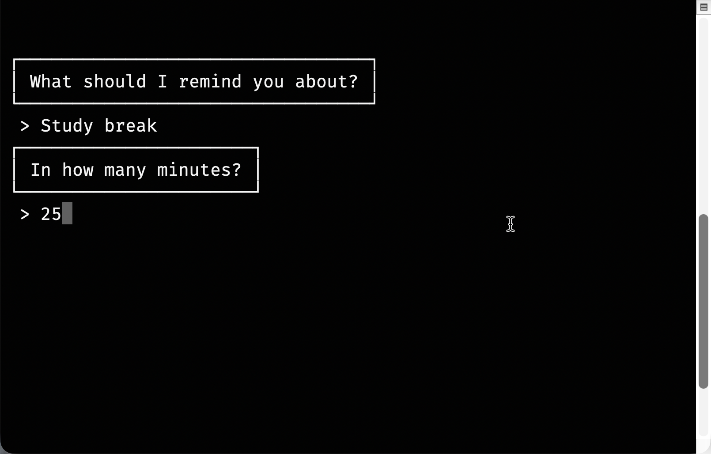
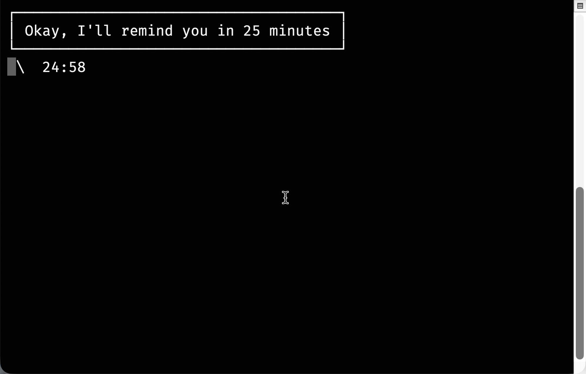

A simple python command line timer.

Starting the timer with a value will set it for that many minutes

    timer 5

Starting the timer with a time value and message will display that message.

    timer 20 "Check the roast"

Starting the timer with no cli value will prompt for it:

Add it to your .profile

    alias timer='/path/to/project/timer.py'

Change out the wav file for any other alarm sound you prefer.

On macOS, the timer uses `afplay`. On Linux, it uses `aplay`; install it
with `sudo apt install alsa-utils` on Ubuntu or `sudo pacman -S alsa-utils`
on Omarchy/Arch. If the required player or alarm file is unavailable, you can
continue without sound or quit.
